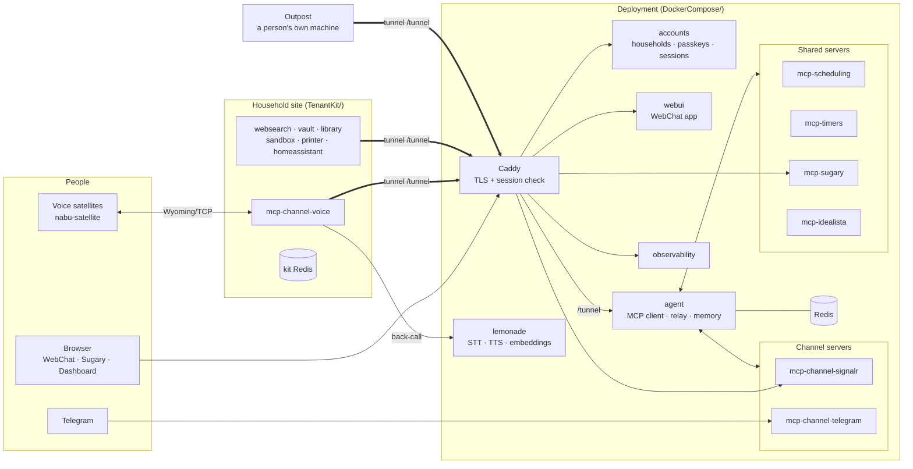
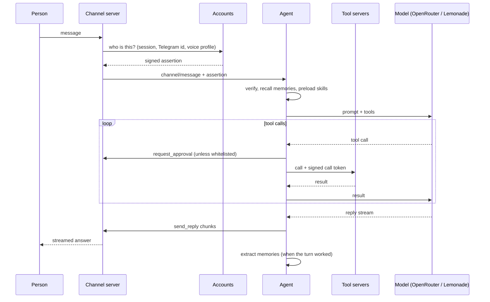
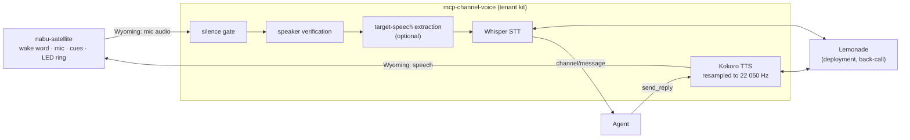

# Ziggurat

A self-hosted AI assistant for households. People reach it from a browser chat, Telegram and voice
satellites around the house. It works through MCP servers: notes, the web, a Linux sandbox, a media
library, Home Assistant, a printer, timers, schedules and a carb-counting log. It also keeps a
memory of each person. Models come from OpenRouter, or from a Lemonade box on the local network.

One **deployment** serves any number of **households**. The deployment runs the agent, the channels,
the accounts service and the servers every household shares. Each household runs its **own servers**
at its own site, as the tenant kit. They reach the deployment through one outbound tunnel each, so
no port is opened on the household's network.

## Contents

- [What it does](#what-it-does)
- [Architecture](#architecture)
- [Households, people and identity](#households-people-and-identity)
- [Agents](#agents)
- [Channels](#channels)
- [Servers and mounts](#servers-and-mounts)
- [Voice](#voice)
- [Sugary](#sugary)
- [Observability](#observability)
- [Projects](#projects)
- [Running it](#running-it)
- [Testing](#testing)
- [Further reading](#further-reading)

## What it does

- **Chat anywhere.** WebChat is an installable Blazor WebAssembly app. It offers topics, live
  streaming that resumes after a dropped connection, and file and image attachments. You can
  dictate, edit a message and branch into a new version, queue messages behind a running answer or
  steer the answer mid-turn, and get push notifications. Telegram uses one shared bot plus any bots a
  household owns. Voice runs through Raspberry Pi satellites with on-device wake words.
- **Households.** People sign in with passkeys. Each household has its own agents, spaces, keys,
  member roles and usage records. Owners manage the household from an admin area in WebChat, and
  the operator manages every household from the dashboard.
- **One filesystem over every server.** Each MCP server can expose a `filesystem://` mount. The agent
  works over all of them with a single set of file tools (glob, read, search, create, edit, move,
  copy, remove, exec, info) and can move or copy files across mounts. A Home Assistant device, a
  schedule, a timer, a print job and a download are all files or *action files* in that tree.
- **A real shell.** The sandbox is an isolated Linux container where commands run with bash and
  Python. A FUSE daemon shows each command the session's other mounts as ordinary directories, so a
  script can read `/vault` or run an action under `/ha` directly.
- **Home control.** The agent operates Home Assistant and Music Assistant, sets countdown timers that
  ring on the satellites, and sets calendar alarms. It can also create *watches*: standing
  instructions that fire when something in the home, or a person's glucose reading, meets a
  condition.
- **Web.** The agent searches through Brave and browses with Camoufox, an anti-detect Firefox, using
  accessibility snapshots, element refs, tabs and page images. When a site needs a login, the agent
  hands it to the person: they sign in on a live view of the tab, and the agent continues in that
  session.
- **Memory.** After a turn succeeds, the agent extracts memories, recalls them by vector similarity
  on later turns, and consolidates them nightly ("dreaming"). Jev judgments filter what gets kept.
- **Schedules, timers and watches** run agent prompts or announcements later, as the person who set
  them up. The person's authority is carried by a delegation the agent signed.
- **Skills.** Detailed task guidance ships with the server whose tools it covers. The model loads it
  on demand, or the host preloads it when a typed judgment is confident the request needs it.
- **Choice of model per turn.** Each agent lists *patchable models* a person may pick for one turn.
  This includes chat models discovered on a household's own Lemonade box.
- **Observability.** Every service publishes metrics into a dashboard: tokens and cost, tools, errors,
  latency, voice, schedules, memory, skills, web, household health and usage.

## Architecture



- **Channels** are MCP servers the agent dials. A channel pushes `channel/message` and
  `channel/cancel` notifications to the agent. The agent answers through the channel's
  `send_reply`, `request_approval`, `create_conversation` and `register_agents` tools.
  `ChannelProtocol` is the wire format. Adding a transport means adding a channel server; the agent
  does not change.
- **Some servers are both a channel and a tool server.** Scheduling, timers, the library, Home
  Assistant, web search and Sugary all have tools, and they also need to start turns of their own: a
  due schedule, a finished download, a watch firing, a login wake, a meal estimate. For these
  servers the channel-protocol tools are hidden from the model.
- **Shared servers** answer every household. Each call carries a call token the agent signed, which
  names the household and person the call acts for.
- **Own servers** never get dialled. Each one opens a WebSocket tunnel to the **relay** inside the
  agent. Everything the agent sends them travels inside that tunnel. A small allowlist of
  **back-calls** goes the other way: metrics, the sandbox's file bridge, and voice's speakers, topics
  and speech. If a household's server is not connected, turns go ahead without its tools and the
  model is told that server is offline.

### A turn



## Households, people and identity

The `accounts` service owns households, people, roles, passkeys, invites, recovery links, sessions,
tunnel credentials and each household's configuration. It is a plain ASP.NET Core host on SQLite.
Caddy puts its session check (`/accounts/verify`) in front of every app. The service signs an
**assertion** that names the person and the channel. Apps, channels and the agent trust only that
signed assertion, never a header or name a client sent.

- **People** sign in with passkeys. Owners invite people from the members page. Telegram users link
  their numeric Telegram id to an account through an invite or a link code. A voice profile is named
  after its owner's user id, and audio that matches no profile counts as the household's *guest*.
- **Household configuration** is stored in versioned sections: settings, agents, keys, features and
  spaces. Secrets in it are sealed under the household's own key. Each server reads only the view it
  needs. Owners edit everything from the admin area in WebChat. When two owners save stale copies,
  the saves merge item by item.
- **Keys** belong to the household: an OpenRouter key and credit, Idealista, its own Telegram bots,
  and an optional Lemonade box. The home household pays with the deployment's key.
- **Signing.** The accounts service signs assertions. The agent signs **call tokens** for each tool
  call, bound to one server, and **delegations** for deferred work such as a schedule's fire, a
  watch's fire or a login wake. Both publish their keys as JWKS, and both have
  `rotate-signing-key` / `retire-signing-keys` commands.
- **Tunnel credentials** are minted per household and per server name by the operator
  (`mint-tunnel-credential`). A credential is shown once, stored only as a hash, and can be revoked
  instantly.

## Agents

An agent definition sets the agent's model, reasoning effort, provider routing, servers, features
(`filesystem`, `subagents`, `memory`, ...), tool whitelist, prompt sections and custom instructions.
Each definition belongs to a household. It is either a full definition or a shipped **template**
(`Domain/Prompts/Agents/`) with the household's own id, name and instructions:

| Template | What it is                                                                                                                                                          |
|----------|---------------------------------------------------------------------------------------------------------------------------------------------------------------------|
| `jonas`  | General personal assistant: every shared server (schedules, timers, Sugary, Idealista) and every kit server (vault, sandbox, web search, Home Assistant, library, printer), with memory, subagents and outposts. Only the servers the household has set up and the features it has switched on are reached |
| `nabu`   | The same toolset driven by speech: one short spoken sentence per answer, routed for a fast first word. No household gets one by default; adding one sets up voice  |
| `sugary` | Carb estimation for the Sugary app. Has no tools and never suggests doses                                                                                          |

A household with no agents saved gets `jonas` (its default agent) and `sugary`. The home household
runs tuned full definitions instead, plus `jack`, a media-library and downloads agent. Agents can be added or edited on the admin
area's Agents page. A separate signed agent registration API (`/api/agents`) lets a companion app
register a person's own agents.

- **Subagents.** An agent with `subagents` can spawn ephemeral workers with `run_subagent`. A worker
  runs on its parent's model and routing, keeps no history and cannot spawn further workers. It
  reaches outposts only if both the parent and the worker allow it.
- **Tool approval.** A tool call not covered by the agent's whitelist asks the person first. They can
  approve once, always approve for this session, or reject. Whitelist patterns look like
  `domain__filesystem*` or `mcp__websearch*`.
- **Prompt.** The system prompt is built from declared sections (`Domain/Prompts/Sections/`), with an
  order, budgets and conflict rules checked at assembly. Task-specific guidance lives in **skills**
  (`Domain/Prompts/Skills/`). Each skill is shipped by the server whose tools it explains and loaded
  only when needed.
- **Models.** Requests go to OpenRouter with per-agent provider routing (always enforced, including
  on a patched turn). A turn can instead go to a household's own **Lemonade chat host**, whose models
  are discovered rather than configured. Small typed decisions use **Jev** (TypeSafe): skill preload,
  memory judgments, dismissing a page's overlays, and screening a sandbox command before it runs.
- **Chat commands:** `/cancel` stops the running turn and keeps the history. `/clear` clears the
  conversation.

## Channels

| Channel     | Server                 | Runs in    | What it carries                                                                                         |
|-------------|------------------------|------------|---------------------------------------------------------------------------------------------------------|
| `signalr`   | `mcp-channel-signalr`  | deployment | WebChat: topics, spaces, streams, queue and steering, attachments, dictation, Web Push, approvals; holds review copies of other channels' conversations |
| `telegram`  | `mcp-channel-telegram` | deployment | The shared bot and each household's own bots, inline-keyboard approvals, `/agent` to switch agents per chat |
| `voice`     | `mcp-channel-voice`    | tenant kit | Wyoming hub for the satellites (see [Voice](#voice))                                                    |
| `scheduling`| `mcp-scheduling`       | deployment | Fires due cron and one-shot schedules                                                                    |
| `timers`    | `mcp-timers`           | deployment | Rings a timer on its owner's channels when no satellite can ring it                                      |
| `library`   | `mcp-library`          | tenant kit | Download-completion alerts to the conversation that started the download                                |
| `homeassistant` | `mcp-homeassistant` | tenant kit | Home watch fires                                                                                         |
| `websearch` | `mcp-websearch`        | tenant kit | Login wakes, after a person finishes a login handoff                                                     |
| `sugary`    | `mcp-sugary`           | deployment | Meal estimates from the Sugary app, and glucose watch fires                                              |

A turn's replies go to the conversation a person can open. For a scheduled task, that is the
conversation it delivers into, not the schedule. A schedule or watch that names no channel delivers
to the deployment-wide default in `Domain/delivery.json` (`signalr`).

## Servers and mounts

Each filesystem server derives its `fs_*` tools and its `filesystem://` resource from its backend
class. The agent discovers mounts when a session starts and resolves each path by its longest
matching prefix. A mount declares whether it can be written to and where a person's attachments may
land.

| Server              | Mount                     | Runs in    | What it is                                                                                                   |
|---------------------|---------------------------|------------|--------------------------------------------------------------------------------------------------------------|
| `mcp-vault`         | `/vault`                  | tenant kit | Markdown notes (an Obsidian vault)                                                                            |
| `mcp-sandbox`       | `/sandbox`                | tenant kit | Linux container for `exec` (bash, Python), with a persistent home and FUSE views of the other mounts. A Rust root launcher (`sandbox-runtime/`) runs each command in its own mount namespace, with no capabilities and a syscall filter, on a network of its own |
| `mcp-websearch`     | —                         | tenant kit | `web_search`, `web_browse`, `web_snapshot`, `web_action`, `view_image`, `web_login(s)` over Camoufox; login handoff and per-person browser contexts |
| `mcp-library`       | `/media`                  | tenant kit | Torrent search and download through Jackett and qBittorrent. Live downloads appear as status files; removing one cancels it |
| `mcp-homeassistant` | `/ha`, `/watchers`        | tenant kit | Entities and areas as directories, live `state.json`, entity history, one action file per service, the alarms calendar and Music Assistant; a home watch is a real HA automation at `/watchers/<id>/watch.json` |
| `mcp-printer`       | `/print-queue`            | tenant kit | IPP/CUPS printer: copying a file in prints it, removing it cancels. Accepted formats come from `SupportedFormats` |
| `mcp-scheduling`    | `/schedules`              | deployment | Cron and one-shot agent prompts per household, in the household's time zone; `./run_now` fires one immediately |
| `mcp-timers`        | `/timers`                 | deployment | Countdown timers per household; they ring on the satellites through voice's tunnel; `./dismiss` silences them |
| `mcp-sugary`        | `/sugary`, `/watchers`    | deployment | A person's Sugary log as Parquet tables queried with DuckDB SQL (`query`); glucose watches share `/watchers` with the home's |
| `mcp-idealista`     | —                         | deployment | Real-estate search on Idealista using the household's own key                                                |
| outpost             | `outpost:<name>`          | any machine | A real machine's own files. See below                                                                        |

**Outposts.** `McpServerOutpost` is a self-contained `linux-x64` binary. Run it on any machine and
that machine's files become available to the agent for as long as it is on. It has no Dockerfile
and no compose service, and needs no configuration on the deployment. It takes flags and opens its
own tunnel, using a credential minted for `outpost-<name>` and read from the `CREDENTIAL`
environment variable:

```bash
CREDENTIAL=... ./McpServerOutpost --name laptop --dir ~/project --jailed --hub https://assistants.example.com
./scripts/run-outpost.sh --name <name> --dir ~/ --exec --install-service   # publish, run, and install a systemd user unit
```

`--jailed` confines every operation to `--dir`, and `--exec` allows commands. An agent sees its
household's open outposts only when its definition sets `usesOutposts`.

## Voice



- The hub is the Wyoming **client**. It dials every satellite listed in the kit's `satellites.env`
  and keeps each connection open. Satellites detect the wake word on the device; a button or foot
  switch also starts a turn.
- Speaker verification drops voices that are not enrolled, such as the TV or guests, before STT
  runs. A recognised speaker acts as their own account. Enrol a speaker with
  `scripts/enroll-voice.sh <user id>`.
- Replies are spoken as they stream. After a reply, a short follow-up window lets the person
  continue without the wake word.
- The hub's announce endpoints ring timers, calendar alarms and watch announcements on any
  satellite. An alarm can repeat until someone acknowledges it.
- **`nabu-satellite`** (`satellite/`) is a fully static Rust binary for Raspberry Pi. It runs
  openWakeWord through tract, keeps a zero-lag pre-roll buffer, plays audio cues, drives the
  reSpeaker XVF3800 LED ring and ducks music during a turn. To set one up,
  `scripts/provision-satellite-rs.sh <user@host>` builds the binary, installs it and installs its
  service. On WSL, `scripts/wsl-satellite.sh` runs a satellite instead. See
  [`satellite/README.md`](satellite/README.md).
- **`speech-typist`** (`speech-typist/`) is a Windows tray program. Hold a key, and your words are
  typed into the window in front. It calls the deployment's Lemonade directly and never talks to an
  agent. See [`speech-typist/README.md`](speech-typist/README.md).

## Sugary

Sugary is a carb-counting PWA for people with type 1 diabetes (`Sugary.Client`, React + Vite). It is
served by `mcp-sugary` on its own host behind the session check. A person photographs, films,
describes or scans a meal, and the `sugary` agent estimates its carbohydrates. The app also logs
insulin doses (never pre-filled), pens with replacement reminders, exercise, periods with a forecast,
recipes and a household pantry. It also reads glucose from LibreLinkUp. The log is SQLite in its own
volume, and every row belongs to one person
([ADR 0043](docs/adr/0043-sugarys-log-is-sqlite-in-its-own-volume.md)). The agent reads the log
through `/sugary` and can create glucose watches.

## Observability

Every host publishes metric events, which never block and never fail (`AddMetricsPublishing`).
Shared services publish into Redis, and own servers send theirs back over their tunnels. The
`observability` service aggregates the events and serves the **dashboard**, a Blazor WebAssembly
PWA available only to the operator. Its pages:

- Overview
- Tokens and cost, by person, model and household
- Tools
- Errors
- Latency
- Voice
- Schedules
- Memory
- Skills
- Web
- Households: the household list, usage and suspension, plus each own server's health tile

## Projects

| Project                  | What it is                                                                                     |
|--------------------------|------------------------------------------------------------------------------------------------|
| `Agent`                  | Composition root: agents, conversation groups, the tunnel relay, memory, the VFS bridge, topic minting, signing commands |
| `Domain`                 | Business logic, contracts, prompts, skills and templates, the channel protocol, signing         |
| `Infrastructure`         | Adapters: MCP clients, OpenRouter, Lemonade, Redis, tunnels, metrics sinks, IPP, Playwright      |
| `Mcp.Hosting`            | What being an MCP server means: settings binding, channel servers, the tunnel, call-token checks |
| `Accounts`               | Households, people, passkeys, sessions, assertions, household configuration, tunnel credentials, the admin API |
| `McpChannelSignalR` / `McpChannelTelegram` / `McpChannelVoice` | Channel servers                                                  |
| `McpServerVault` / `McpServerSandbox` / `McpServerWebSearch` / `McpServerLibrary` / `McpServerHomeAssistant` / `McpServerPrinter` | A household's own servers |
| `McpServerScheduling` / `McpServerTimers` / `McpServerSugary` / `McpServerIdealista` | Shared servers                                 |
| `McpServerOutpost`       | The outpost binary                                                                             |
| `LemonadeForwarder`      | A household's tunnel to its own Lemonade box, so the box's key never leaves the house           |
| `HouseholdMigration`     | One-shot migration that moved the single-user deployment into the home household                |
| `WebChat` / `WebChat.Client` | The chat app and its host                                                                  |
| `Observability` / `Dashboard.Client` | Metrics collector, API and hub, and the operator's dashboard                       |
| `Sugary.Client`          | The Sugary PWA (TypeScript, built into the `mcp-sugary` image)                                  |
| `satellite/`             | `nabu-satellite`, the Rust voice satellite                                                     |
| `sandbox-runtime/`       | The sandbox's Rust root launcher and FUSE daemon                                               |
| `speech-typist/`         | The Windows speech typist (Rust)                                                               |
| `DockerCompose/`         | The deployment's compose files, Caddy, Lemonade, AppArmor and seccomp profiles                 |
| `TenantKit/`             | A household's own servers as a compose file                                                    |
| `Tests/`                 | Unit, integration, E2E, canary, smoke and eval tiers                                           |

The three Rust crates are standalone. Each has its own `CLAUDE.md` and shares no build with the
others or with the .NET solution.

## Running it

### Prerequisites

- Docker with Compose, and the [.NET 11 SDK](https://dotnet.microsoft.com/download) for development
- An [OpenRouter](https://openrouter.ai/) API key
- A domain whose DNS is on Cloudflare: Caddy gets Let's Encrypt certificates through the DNS challenge
  (`CF_API_TOKEN`). `DockerCompose/caddy/Caddyfile` names the operator's own hosts; replace the main,
  dashboard and Sugary hosts with your own, and remove any site block whose upstream is not a service
  in the compose file
- Optionally: a Telegram bot token for the shared bot, and a GPU or NPU for Lemonade

### The deployment

1. Fill in `DockerCompose/.env`. The comment above each value says what it is and, for generated
   keys, how to make one: the MCP secrets, `REDIS_PASSWORD`, `HOUSEHOLD_CONFIG_MASTER_KEY` (keep a
   copy: losing it loses every household's sealed keys), `OPENROUTER__APIKEY`, the Web Push keys,
   `SUGARY_SEALING_KEY`, `CF_API_TOKEN` and `TELEGRAM_SHARED_BOT_TOKEN`. Services also read .NET user
   secrets, which the OS override mounts and which win over `.env`.
2. Build the base image first. Every image builds from it, and `up --build` reuses a stale copy:

   ```bash
   docker compose -f DockerCompose/docker-compose.yml -p jackbot build base-sdk
   docker compose -f DockerCompose/docker-compose.yml -f DockerCompose/docker-compose.override.linux.yml -p jackbot up -d --build
   ```

   Use `docker-compose.override.windows.yml` on Windows. On a host with no `/dev/dri`, add
   `docker-compose.override.no-dri.yml` last. `docker-compose.override.npu.yml` and
   `docker-compose.override.nvidia.yml` select other Lemonade tiers.
3. Create the operator's sign-in link, open it, and enrol a passkey:

   ```bash
   docker exec accounts dotnet Accounts.dll mint-link --operator --name "<your name>"
   ```

   The operator is an owner of the home household. Invite the rest of the household from WebChat's
   members page; an invite opened in Telegram links that person's Telegram account too
   ([Telegram's ways in](.claude/rules/telegram.md): `/start`, `/web`, `/bind`, `/agent`).

The base compose file publishes only Caddy (443), Redis on loopback, and Lemonade on
`LAN_BIND_ADDRESS` for the speech typist. `docker-compose.override.ports.yml` also publishes the
agent (5000), WebChat (5001), the dashboard (5003), accounts (5004) and the shared servers (6005–6017)
on `127.0.0.1`, so projects can run on the host against the stack (`scripts/run-local.sh`, or the
`.vscode` / `.zed` launch profiles). The [`launch-stack` skill](.claude/skills/launch-stack/SKILL.md)
covers the details: secrets, signing keys, reaching an app directly, and Playwright.

### A household's own servers

Without its own servers, a household still chats. Its turns are told that the vault, the web, the
sandbox and the rest are offline. To add them, mint one tunnel credential per server, then start the
tenant kit at the household's site:

```bash
for s in websearch vault library sandbox printer homeassistant voice; do
  docker exec accounts dotnet Accounts.dll mint-tunnel-credential --household <id> --server $s
done
# put each in TenantKit/.env as TUNNEL_CREDENTIAL_<SERVER>, satellites in TenantKit/satellites.env
docker compose -f TenantKit/docker-compose.yml build base-sdk
docker compose -f TenantKit/docker-compose.yml up -d --build
docker exec agent dotnet Agent.dll list-household-servers --household <id>
```

The sandbox needs the `ziggurat-sandbox` AppArmor profile from `DockerCompose/apparmor/` installed on
the host. [`TenantKit/README.md`](TenantKit/README.md) lists every server, its tunnel name and its
back-calls, and covers `.env`, the optional Lemonade forwarder, and how the home household moved
into the kit. Home Assistant's first run is described in
[`.claude/rules/home-assistant.md`](.claude/rules/home-assistant.md).

### Persistence

| Where                                   | What                                                                                       |
|-----------------------------------------|--------------------------------------------------------------------------------------------|
| Deployment Redis                        | Conversation history, topics, memories (vector search), schedules, push subscriptions, metrics, service health |
| Kit Redis                               | Web search's remembered logins and links, the library's download routing                    |
| `volumes/accounts` (SQLite)             | Households, people, passkeys, sessions, configuration, tunnel credentials                  |
| `mcp-sugary`'s volume (SQLite)          | The Sugary log                                                                              |
| `volumes/agent-keys`                    | The agent's signing key; losing it means schedules and watches need `Agent.dll redelegate`  |
| Kit volumes                             | Vault, media, sandbox home, Home Assistant, voice profiles, the browser's identity, the print spool |

Topics are archived and then purged on the horizons set in `Domain/retention.json`.

## Testing

```bash
dotnet test
```

- `Tests/Unit` runs on its own. Integration and E2E tests need Docker; their fixtures start
  testcontainers or the compose stack themselves. Set `PLAYWRIGHT_HEADLESS=false` to watch the
  browser.
- Every test talks to a fake OpenRouter except the two **canaries** (`Tests/Canary/`), which cost
  real model calls. A test outside `Tests/Canary`, `Tests/Eval` and `Tests/Smoke` that reads user
  secrets fails `PaidCallsConformanceTests`.
- The **smoke tier** (`scripts/smoke-stack.sh up|test|down`) runs the shipped compose file and
  Caddyfile from empty state on this machine, with the tenant kit beside them. The **behavioural
  eval** runs scenarios against a real model with the deployment's own agent definitions and writes
  scorecards to `.eval-output/`. Both cost money or need a running stack, so they run only when asked
  ([`test-tiers` skill](.claude/skills/test-tiers/SKILL.md)).
- The Rust crates run `cargo test` in their own directories, with no .NET build and no Docker.
- The pre-commit hook (`.githooks/pre-commit`) runs `dotnet format` over staged `.cs` files.

## Further reading

- [`CONTEXT.md`](CONTEXT.md) is the glossary: what each term means here and which words to avoid.
- [`docs/adr/`](docs/adr/) holds the architecture decisions.
- [`.claude/rules/`](.claude/rules/) holds per-subsystem contracts (channels, VFS, tunnel, accounts,
  voice, sandbox, scheduling, ...).
- [`TenantKit/README.md`](TenantKit/README.md), [`satellite/README.md`](satellite/README.md) and
  [`speech-typist/README.md`](speech-typist/README.md).
- [`docs/home-assistant-bridges.md`](docs/home-assistant-bridges.md) explains the Home Assistant
  automations that bridge alarms and watches.

## License

[CC BY-NC-ND 4.0](LICENSE) - Attribution-NonCommercial-NoDerivatives 4.0 International
